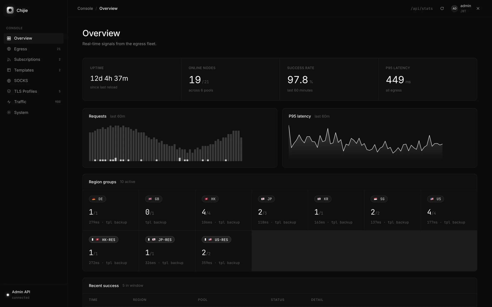
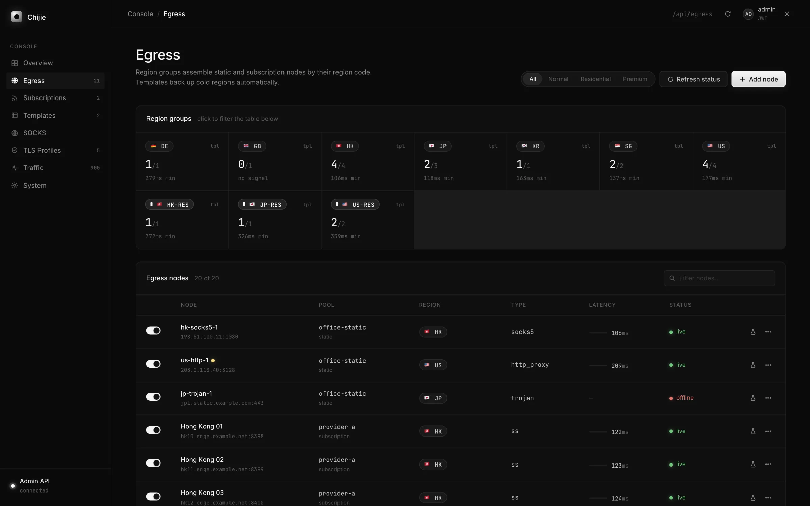
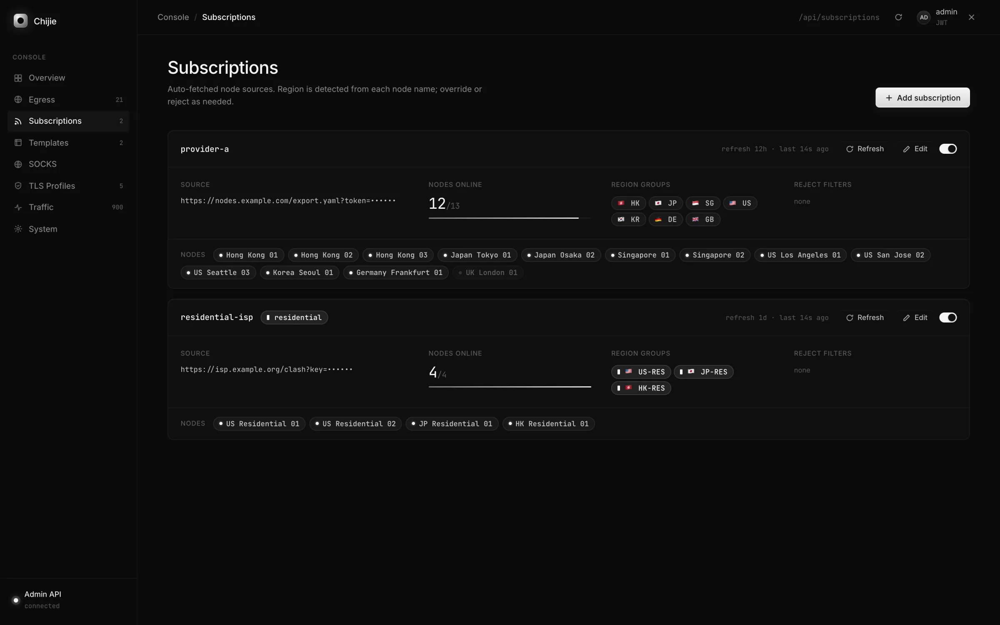
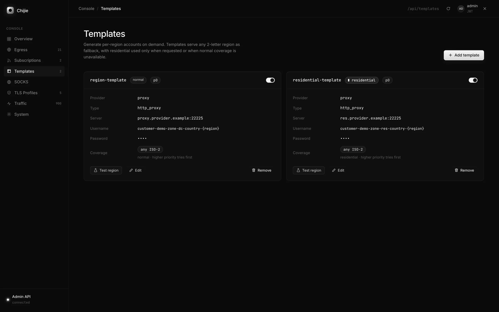
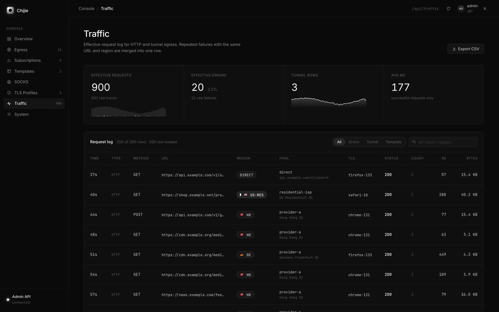
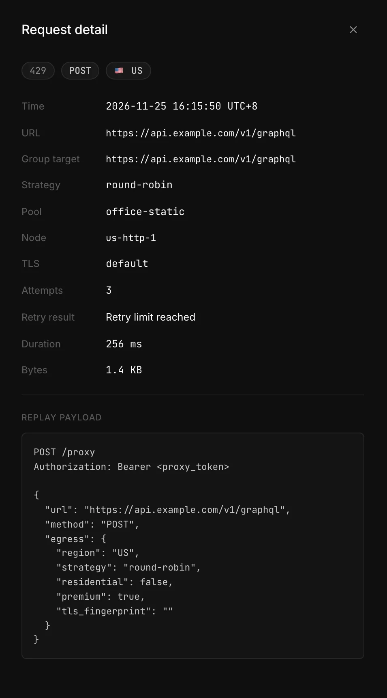
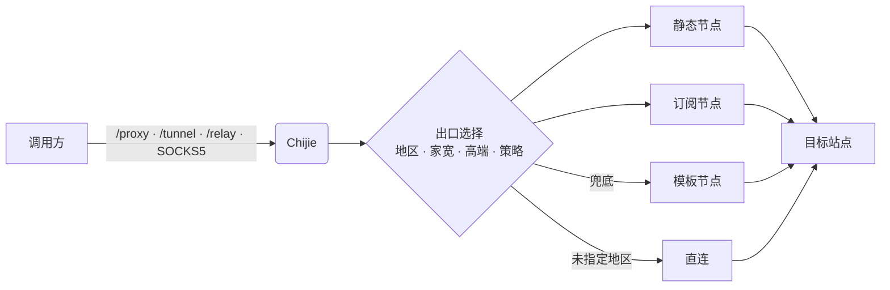

# Chijie

> 本项目原先由 GitHub 账号 ahaduoduoduo 发布。该账号被停用后，项目转到当前账号 aha-duoduoduo 继续维护。

Chijie 是一个参数驱动的出口网关。调用方把目标请求和出口要求（地区、家宽、高端节点、TLS 指纹）一起交给网关，网关从节点池里选择出口、执行请求，并在出口失败时自动切换节点。

它适合需要从不同地区访问外部服务的服务端程序，例如跨地区接口测试、多地区可用性监测，或任何不想在业务代码里管理代理节点的场景。



> 截图均使用演示数据。

## 功能

**统一入口**

- `POST /proxy`：提交目标 URL、方法、Header、Body 和出口参数，返回目标站点的原始响应。
- `WS /tunnel`：首帧声明目标和出口参数，之后双向转发，支持 raw TCP 和上游 WebSocket。
- `WSS /relay/v1`：按连接转发 TCP 字节流或 UDP 数据报，可嵌套多级网关。
- SOCKS5：单端口、多账号，每个账号绑定一套出口策略，支持 TCP CONNECT 和 UDP ASSOCIATE。
- Linux TUN：可选的整机 TCP/UDP 入口，经 WSS 连接远端网关。

**出口管理**

- 节点来源：静态节点、订阅（Clash YAML、Base64 或纯 URI 列表）、按地区动态生成账号的模板节点、直连。
- 出口协议：SOCKS5、HTTP Proxy、Shadowsocks、VMess、VLESS（含 Reality、XHTTP）、Trojan、Hysteria2、AnyTLS、TUIC。
- 地区组：订阅节点按名称自动识别地区，分为普通组（`US`、`HK`）和家宽组（`US-RES`）。
- 选择策略：`random`、`round-robin`、`least-latency`；可指定地区，也可以只限制最大延迟。
- 健康检查：后台探测连通性和延迟，失败节点自动下线，恢复后重新启用。

**可靠性**

- 出口失败（拨号失败、EOF、TLS 握手失败）时自动换下一个候选节点，节点全部失败后再用同地区模板兜底。
- 按域名重试：对指定域名的 429、503 等临时错误按上限重试，可切换节点。
- TLS 指纹：内置浏览器预设，也支持 JA3、JA4、Akamai 原始字符串，可按请求指定。

**管理后台**

- 网页管理节点池、订阅、模板、SOCKS 账号、TLS 指纹和访问密钥，修改直接写回配置文件。
- 流量日志按天持久化，同一故障的重复失败合并为一行，可从请求详情生成重放请求。

## 界面

| 出口节点 | 订阅 |
| --- | --- |
|  |  |
| 按地区组查看在线节点和延迟，启用、停用或单独测试节点。 | 订阅自动刷新，节点按名称识别地区；刷新失败时保留上次成功的节点。 |

| 模板节点 | 流量 |
| --- | --- |
|  |  |
| 用户名中的 `{region}` 按请求地区替换，适合按地区生成账号的代理服务。 | 有效请求、错误率和延迟；相同 URL 和地区的重复失败合并显示。 |

点击任意请求可以查看出口节点、重试结果，以及可直接复制的重放请求：

<p align="center"></p>

## 工作方式



1. 没有指定地区、也没有设置 `any` 或 `premium` 时直连；`any: true` 时选任意非直连节点。
2. 指定地区时，在对应地区组（家宽请求使用 `-RES` 组）里按策略选节点；`premium: true` 优先使用高端节点。
3. 出口失败时换下一个节点，默认最多尝试 5 个；仍然失败时使用同地区的模板节点。
4. 目标站点已经返回 HTTP 状态码（如 403、502）时不换节点，状态码原样返回；配置了按域名重试的除外。

完整规则见 [参数驱动出口模型](docs/parameter-driven-egress.md)。

## 快速开始

### 1. 启动

需要 Docker 和 Docker Compose。

```bash
git clone https://github.com/aha-duoduoduo/ChiJie.git chijie && cd chijie
cp .env.example .env
cp configs/gateway.docker.yaml.example configs/gateway.yaml
cp configs/nodes.yaml.example configs/nodes.yaml
cp configs/fingerprints.yaml.example configs/fingerprints.yaml
```

编辑 `configs/gateway.yaml`，设置管理员密码和 JWT 密钥（可用 `openssl rand -hex 32` 生成）：

```yaml
admin:
  password: "your-strong-password"
  jwt_secret: "<openssl rand -hex 32 的输出>"
```

在 `configs/nodes.yaml` 里填入你的节点或订阅地址（也可以启动后在后台添加），然后启动：

```bash
docker compose up -d --build
curl http://127.0.0.1:18080/health   # {"status":"ok"}
```

默认端口都只绑定本机地址，可在 `.env` 中修改：

| 服务 | 地址 |
| --- | --- |
| Proxy API | `http://127.0.0.1:18080` |
| 管理后台 | `http://127.0.0.1:19090` |
| SOCKS5 | `127.0.0.1:11080` |

### 2. 创建访问密钥

打开管理后台，进入 **System → Create token**，生成访问密钥。密钥可设置有效期或永不过期，之后可在后台查看、复制和注销。

### 3. 发送请求

```bash
curl http://127.0.0.1:18080/proxy \
  -H "Authorization: Bearer $CHIJIE_TOKEN" \
  -H "Content-Type: application/json" \
  -d '{
    "url": "https://httpbin.org/ip",
    "egress": { "region": "US", "strategy": "least-latency" }
  }'
```

响应就是目标站点的原始状态码、`Content-Type` 和响应体。

## 请求参数

```json
{
  "url": "https://api.example.com/v1/search?q=test",
  "method": "POST",
  "headers": { "Content-Type": "application/json" },
  "payload": "{\"hello\":\"world\"}",
  "follow_redirects": false,
  "egress": {
    "region": "US",
    "strategy": "least-latency",
    "residential": false,
    "premium": false,
    "tls_fingerprint": "chrome"
  }
}
```

| 字段 | 说明 |
| --- | --- |
| `url` | 目标地址，必填 |
| `method` | 请求方法，默认 `GET` |
| `headers` | 目标请求 Header；Cookie 需要显式写入 `headers.Cookie` |
| `payload` | 请求体；`GET`、`HEAD` 不发送 |
| `follow_redirects` | 是否由网关跟随跳转，默认 `false` |
| `egress.region` | 二字母地区码；留空表示直连 |
| `egress.any` | `true` 时选任意非直连节点，可配合 `max_latency_ms` 限制延迟 |
| `egress.strategy` | `random`（默认）、`round-robin`、`least-latency` |
| `egress.residential` | 使用家宽节点 |
| `egress.premium` | 优先使用高端节点，不可用时回到普通候选 |
| `egress.tls_fingerprint` | 指纹名称、内置预设或 JA3 / JA4 / Akamai 原始字符串 |

跳转、Cookie、隧道首帧格式以及 Node.js、Python 示例见 [Proxy API 使用文档](docs/proxy-client-usage.md)。

## 从源码构建

需要 Go 1.26.8 和 Node.js 22。

```bash
./build.sh                       # 构建前端并编译，产物为 ./chijie
./chijie                         # 默认读取 ./configs/
./chijie -config /path/to/configs
```

`with_utls` 构建标签用于 Reality 和 uTLS 指纹，`build.sh` 已默认启用。交叉编译 Linux 版本：

```bash
GOOS=linux GOARCH=amd64 go build -tags with_utls -o chijie ./cmd/gateway/
```

推送到 `main` 后，GitHub Actions 运行测试并构建 Linux AMD64 镜像，发布到 `ghcr.io/<owner>/<repo>`。使用已发布镜像部署时，在 `.env` 中设置 `CHIJIE_IMAGE`，再执行 `docker compose -f docker-compose.prod.yml up -d`。

## 安全默认值

- 管理后台默认只监听本机；没有设置密码时，启动会拒绝监听其他地址。
- `admin.jwt_secret` 为空、少于 16 位或是占位字符串时拒绝启动。
- 默认禁止代理到私网和回环地址，防止 SSRF；订阅地址同样受限，可按池单独放开。
- 登录失败次数过多时临时锁定；访问密钥只能调用代理接口，不能访问管理 API。

完整配置项和资源上限见 [配置说明](docs/configuration.md)。

## 文档

| 主题 | 文档 |
| --- | --- |
| Proxy API、隧道、调用示例 | [proxy-client-usage.md](docs/proxy-client-usage.md) |
| 出口模型与选择规则 | [parameter-driven-egress.md](docs/parameter-driven-egress.md) |
| 配置项、安全与资源上限 | [configuration.md](docs/configuration.md) |
| 出口协议与订阅格式 | [egress-protocols.md](docs/egress-protocols.md) |
| 订阅地区识别、节点元数据 | [subscription-routing.md](docs/subscription-routing.md) |
| 高端出口 | [premium-egress.md](docs/premium-egress.md) |
| 模板兜底与远端 Chijie | [template-fallback.md](docs/template-fallback.md) |
| 按域名重试 | [domain-retries.md](docs/domain-retries.md) |
| TLS 指纹 | [tls-fingerprints.md](docs/tls-fingerprints.md) |
| WSS 中继、SOCKS5、Linux TUN、访问密钥 | [relay-socks.md](docs/relay-socks.md) |
| 流量日志持久化与合并规则 | [traffic-url-grouping.md](docs/traffic-url-grouping.md) |
| Admin API | [admin-api.md](docs/admin-api.md) |
| 管理后台前端 | [admin-frontend.md](docs/admin-frontend.md) |
| Docker 部署 | [docker-deployment.md](docs/docker-deployment.md) |
| 目录与模块职责 | [DETAILS.md](DETAILS.md) |
| 开发计划 | [TODO.md](TODO.md) |
